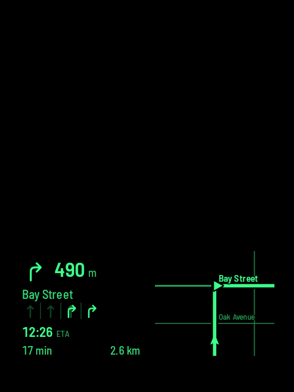
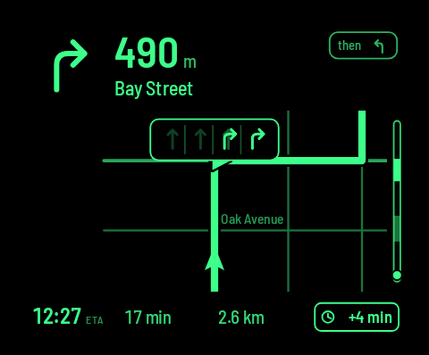
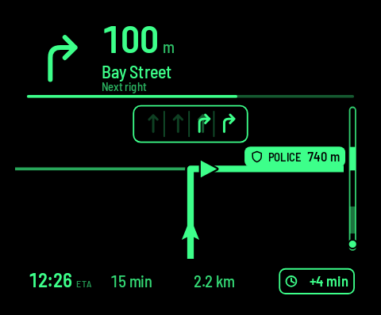

# Rokid Navigation

A Google-Maps-style navigation HUD for **Rokid Glasses**. You pick a destination and route on your
Android phone. The phone runs Google's turn-by-turn guidance and streams compact navigation data to
an app on the glasses, which draws its own monochrome HUD.

| Corner view (default) | Expanded map + lane guidance | Police alert |
|---|---|---|
|  |  |  |

*Captured from the HUD's built-in demo trip. Black is transparent on the glasses.*

## Features
- **Next turn, distance, ETA** and the turn after, from the Google Navigation SDK.
- **Heading-up street map** using OpenFreeMap vector tiles, with the route drawn solid and auto-zoom
  that frames upcoming turns.
- **Lane guidance** in both the corner and expanded views whenever Google provides it.
- **Traffic and detours**: delay chip, plus faster-route offers you accept or dismiss from the touchpad.
- **WzSabre police reports and speed cameras**: passive alerts that clear themselves once passed,
  with an optional voice warning for each new report near your route.
- **Touchpad menu** for trip info, traffic, voice, units and zoom. Double-tap returns to Rokid home,
  and reopening the HUD resumes the trip.
- **Auto-install and update**: the phone sends the HUD to the glasses when you connect.

## How it fits together
| Module | What |
|---|---|
| `protocol/` | Pure Kotlin message types and codec shared by both apps (the contract) |
| `phone/` | Android app: search, route picker, Google guidance, traffic, alerts, Rokid CXR-L link |
| `glasses/` | Android app on the glasses: CXR-S bridge, touchpad input, Canvas HUD |

More detail: [Architecture](docs/ARCHITECTURE.md) · [Protocol](docs/PROTOCOL.md) ·
[HUD design](docs/HUD_DESIGN.md) · [Data sources](docs/DATA_SOURCES.md) · [Tasks](docs/TASKS.md) ·
[Agent rules](AGENTS.md)

## Setup
You need:
- an Android phone with **Hi Rokid** (Rokid AI App) and your glasses paired in it
- a Google Cloud API key with Navigation SDK, Maps SDK for Android, Places API (New) and Routes API
  (see [Google setup](docs/GOOGLE_SETUP.md))
- Android Studio with JDK 17 and SDK 34

Copy `local.properties.example` to `local.properties` and set `sdk.dir` and `MAPS_API_KEY`. The key is
never committed. For police reports, install the [WzSabre](https://wzsabre.rocks/) plugin on the phone.

## Build and test

```powershell
./gradlew.bat :protocol:test :phone:testDebugUnitTest :glasses:testDebugUnitTest assembleDebug
```

Use `./gradlew` on macOS/Linux. Install `phone`, open the **Glasses** tab, authorize and tap
**Connect glasses**. The phone installs or updates the HUD on the glasses automatically.

Street data © OpenStreetMap contributors · tiles © OpenMapTiles, OpenFreeMap.
